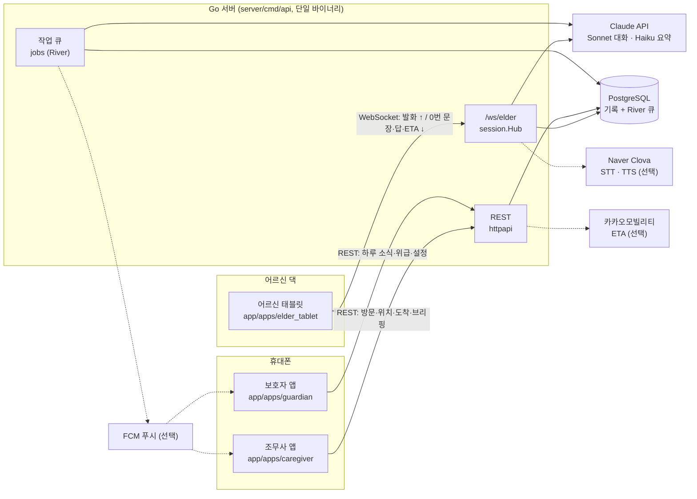
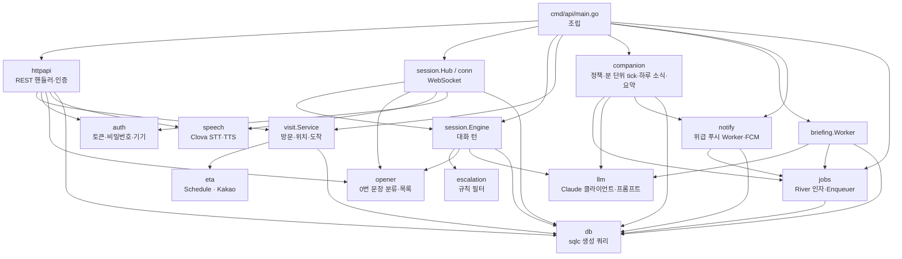
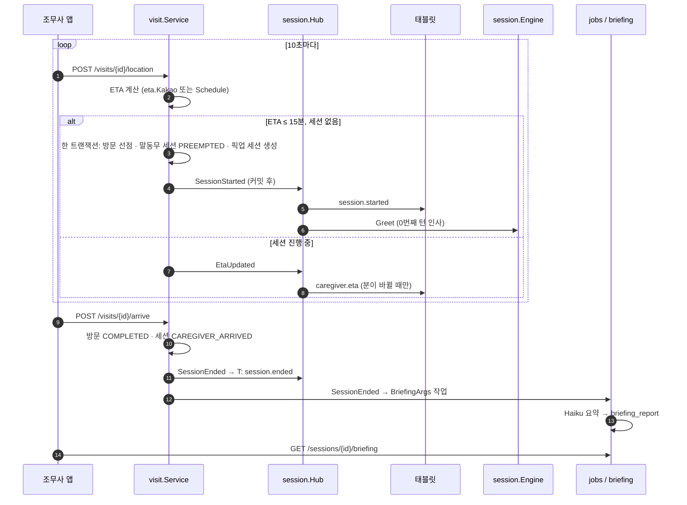
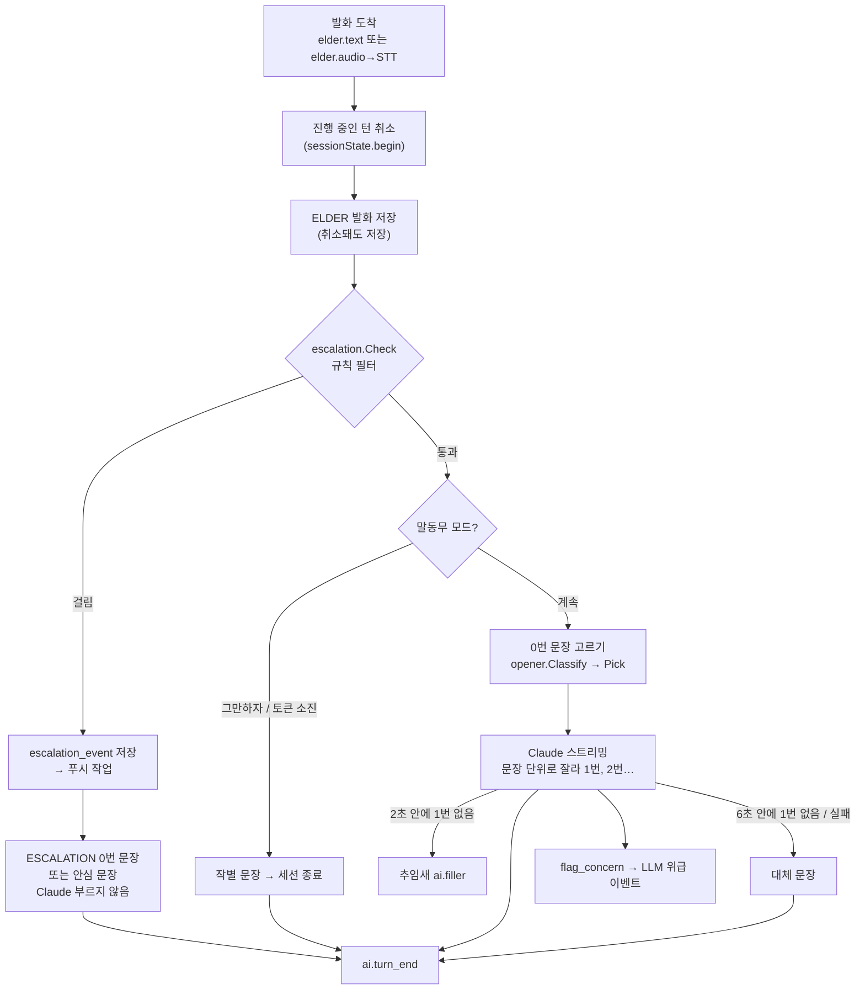
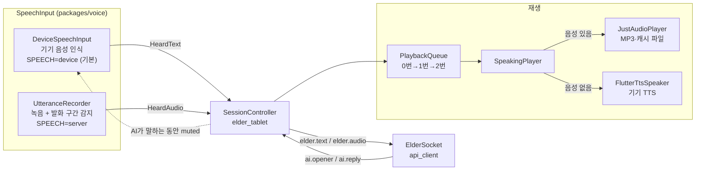
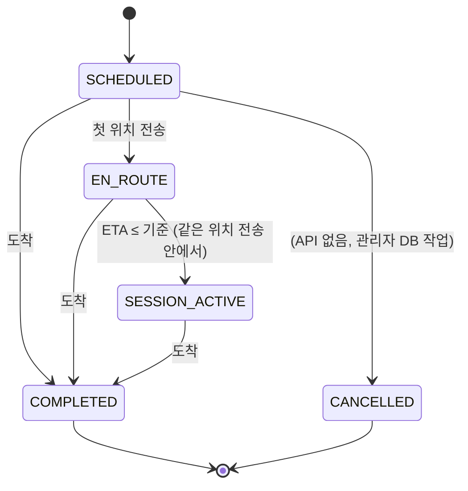
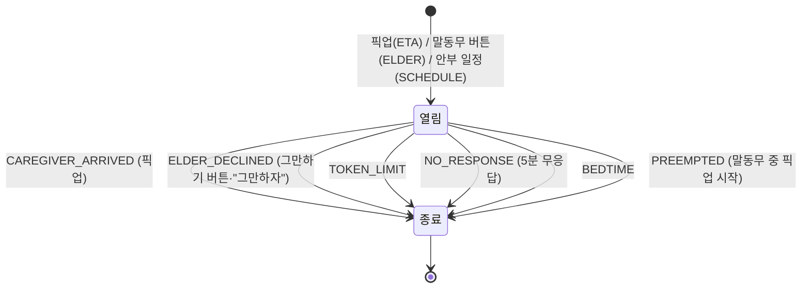
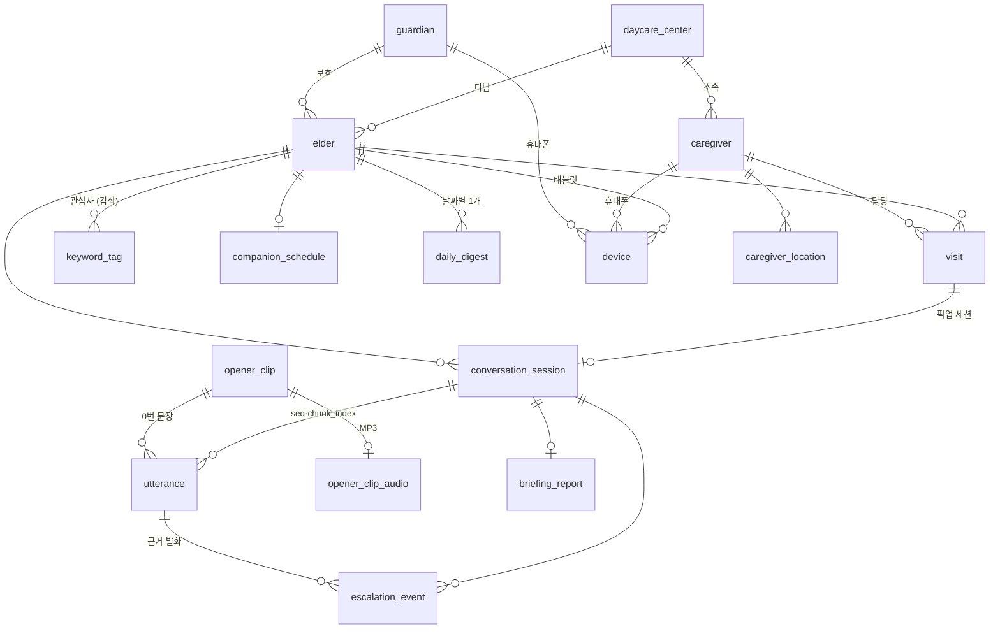
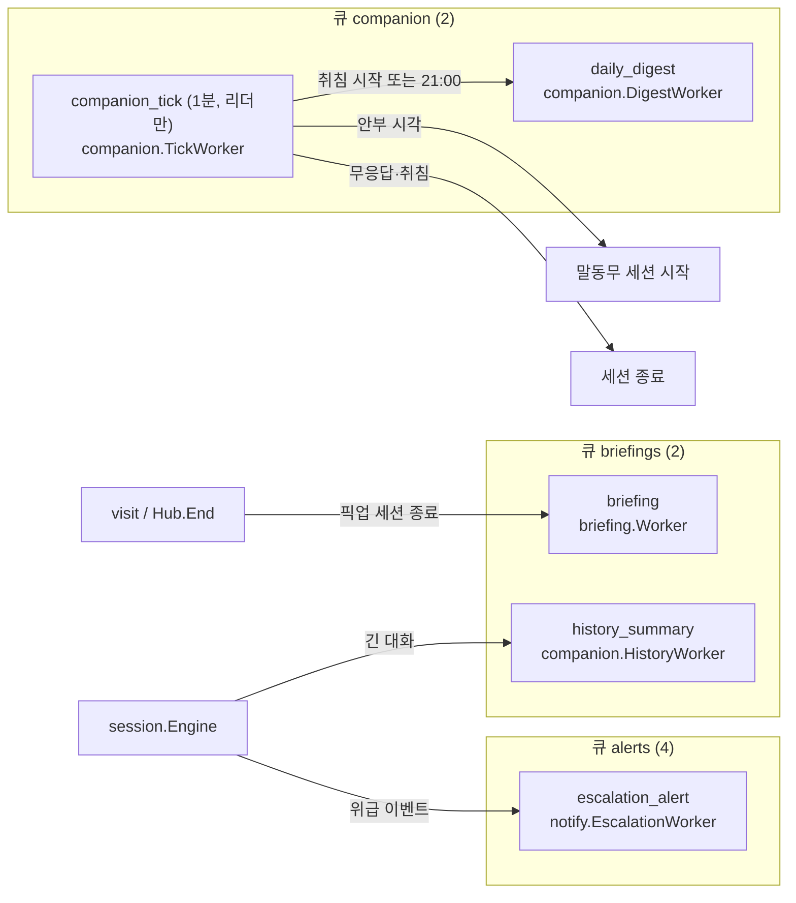

# 화이트박스: 시스템 속 구조

> 기준일: 2026-10-11. 그림은 GitHub에서 바로 그려지는 Mermaid입니다. 각 그림 아래 한 줄이 읽는 법입니다.
> 상자 이름은 실제 패키지·파일 이름이라 그대로 검색하면 코드가 나옵니다.

## 1. 전체 구성

앱 세 개는 서버하고만 통신합니다. 점선은 키가 없으면 대체 동작으로 바뀌는 외부 서비스입니다 (키별 동작은 [status.md](./status.md) 4절). Redis는 docker-compose에 있지만 코드는 아직 쓰지 않습니다.

## 2. 서버 패키지 의존 관계

화살표는 import 방향입니다. `session`은 `visit`·`companion`·`jobs`를 import하지 않고, 그쪽이 `session`이 정의한 작은 인터페이스(`Alerter`, `Budget`, `Compactor`, `EndListener`)를 구현합니다. `main.go`가 `SetAlerter`·`SetBudget`·`SetCompactor`·`AlsoNotify`로 이어 붙입니다.

## 3. 픽업 브릿지: 위치 전송부터 브리핑까지

세션은 동시에 위치가 20건 와도 하나만 생깁니다 (`ClaimVisitSession` 조건부 UPDATE와 `conversation_session_one_open_per_elder_idx`). 알림은 모두 트랜잭션 커밋 뒤에 갑니다.

## 4. 대화 한 턴 (서버 안)

규칙 필터가 항상 먼저이고, 걸리면 Claude는 호출되지 않습니다. 시간 값은 `CONVERSATION_FILLER_AFTER`(2초), `CONVERSATION_FIRST_SENTENCE_TIMEOUT`(6초), `CONVERSATION_TURN_TIMEOUT`(20초)입니다.

## 5. 태블릿 속 음성 경로

`SPEECH`는 빌드할 때 정합니다 (`scripts/dev.sh tablet`은 Clova 키가 있으면 `server`). AI 목소리는 설정이 없고, 서버가 보낸 MP3나 캐시된 0번 문장이 있으면 그것을, 없으면 기기 TTS를 씁니다.

## 6. 상태 전이

### 방문 (`visit.status`)

### 대화 세션 (`conversation_session`)

어르신 한 명에게 열린 세션은 하나뿐입니다 (부분 유니크 인덱스). 종료되면 `ended_at`과 `ended_reason`이 채워지고 다시 열리지 않습니다.

## 7. 데이터 모델

원본은 `server/db/migrations/00001_init.sql`부터 `00007`까지입니다. River 테이블은 서버 시작 때 goose 다음에 따로 만듭니다.

## 8. 비동기 작업

괄호 안 숫자는 큐별 동시 작업 수입니다 (`jobs.NewClient`). 위급 알림은 자기 큐를 써서 브리핑이 밀려도 늦지 않습니다.
